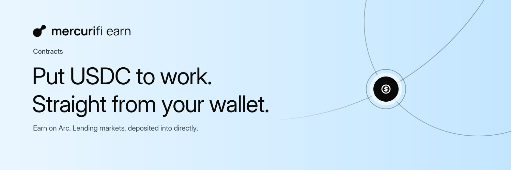

<p align="center">
  <picture>
    <source media="(prefers-color-scheme: dark)" srcset="assets/banner-dark.png">
    
  </picture>
</p>

<p align="center">
  
</p>

<h1 align="center">Mercurifi Earn · contracts</h1>

<p align="center">
  <a href="deployments/manifest-5042002.json"></a>
  <a href="script/write-earn-record.py"></a>
  <a href="#build-and-verify"></a>
  <a href="foundry.toml"></a>
  <a href="LICENSE"></a>
</p>

<p align="center">
  <a href="https://launch.mercuri.finance">launch.mercuri.finance</a> ·
  <a href="https://trade.mercuri.finance">trade.mercuri.finance</a> ·
  <a href="https://docs.mercuri.finance">docs.mercuri.finance</a>
</p>

The Solidity source of Mercurifi Earn. Earn lists lending markets on Arc that a wallet deposits into directly; on Arc
mainnet those are third-party ERC-4626 vaults, and Earn adds no contract between the wallet and the vault. Arc testnet
has no lending protocol, so this repository holds a test vault that stands in for one there. Contracts, the pinned
sources they compile against, the deployment inputs and the release evidence. The backend and the web app are
separate.

Earn's contracts live in their own repository, apart from the Launch, Trade and Agent Accounts contract sets.

**Contents:** [Deployment](#deployment) · [How it works](#how-it-works) · [Contracts](#contracts) ·
[Parameters](#parameters) · [Events](#events) · [Build and verify](#build-and-verify) · [Security](#security) ·
[License](#license)

## Deployment

Nothing is deployed yet. The testnet deployment inputs are in
[`deployments/manifest-5042002.json`](deployments/manifest-5042002.json); its owner is unset, and the deployment
script refuses to run until it names one. The record `deployments/5042002.json` is written only from a completed
broadcast by [`script/write-earn-record.py`](script/write-earn-record.py).

| Contract | Network | Address | Mutability |
| --- | --- | --- | --- |
| `TestLendVault` | Arc testnet | not deployed | Immutable |

Nothing in this repository is deployed to Arc mainnet, and the deployment script refuses mainnet.

## How it works

1. A wallet approves the vault for an exact amount of USDC and calls `deposit`, receiving vault shares.
2. The owner adds USDC with `fund`, without minting shares, so every share is worth more: that is the rate the Earn
   backend reads from the share price.
3. The owner can cap what the vault pays out with `setWithdrawLimit`, as a mostly-lent-out lending vault would; every
   payout lowers the remaining limit, and `maxWithdraw`/`maxRedeem` report it.
4. A holder withdraws or redeems up to that limit.

## Contracts

| Contract | Role | Mutability |
| --- | --- | --- |
| [`TestLendVault.sol`](src/TestLendVault.sol) | ERC-4626 vault over USDC (OpenZeppelin 5.4.0), six virtual share decimals against first-depositor inflation, two-step ownership. Lends nothing. | Immutable |
| [`interfaces/ITestLendVault.sol`](src/interfaces/ITestLendVault.sol) | The vault's own functions and events. | — |

## Parameters

| Parameter | Value | Set by |
| --- | --- | --- |
| Asset | Arc testnet USDC, `0x3600000000000000000000000000000000000000`, 6 decimals | Manifest, at deployment |
| Share decimals | 12 (asset decimals plus a 6-decimal offset) | Code |
| Withdraw limit | `type(uint256).max` (none) at deployment | Owner, `setWithdrawLimit` |
| Owner | The manifest's `owner` | Manifest; two-step transfer |

## Events

| Event | When |
| --- | --- |
| `Funded(uint256 assets)` | The owner added assets without minting shares. |
| `WithdrawLimitSet(uint256 limit)` | The owner set the withdraw limit. |
| ERC-4626 `Deposit`, `Withdraw`; ERC-20 `Transfer`, `Approval`; `OwnershipTransferStarted`, `OwnershipTransferred` | As in OpenZeppelin. The Earn indexer reads `Deposit` and `Withdraw`. |

## Build and verify

```sh
git clone --recurse-submodules https://github.com/mercuri-finance/mercuri-earn-contracts.git
cd mercuri-earn-contracts
forge build
bash script/check-contracts.sh
```

`forge build` uses the pinned settings in [`foundry.toml`](foundry.toml): Solidity 0.8.26, Cancun, via-IR, 200
optimizer runs for `src/**`, no metadata hash. [`lib-versions.md`](lib-versions.md) records every pin.

The gate checks the source manifest, formatting, NatSpec and the record writer's offline self-test, then runs every
test with seed `0x5042` and the gas snapshot. `--stress` adds a 10,000-run fuzz pass.

A dry run of the deployment, with no `--broadcast`, against Arc's public RPC:

```sh
forge script script/DeployTestLendVault.s.sol --rpc-url https://rpc.testnet.arc.io
```

## Security

| | |
| --- | --- |
| Scope | Arc testnet only. The vault holds testnet USDC, which has no value. |
| Mutability | Immutable: no proxy, upgrade or rescue path. |
| Owner | Can add assets and cap payouts; cannot move holders' assets. A zero limit stops every withdrawal, by design. What each role can do: [`SECURITY.md`](SECURITY.md). |

The vault was reviewed with the rest of Earn phase 1; the report is in [`docs/reports/`](docs/reports). This was an
AI-assisted review, not an audit by a security firm. To report a vulnerability, see [`SECURITY.md`](SECURITY.md).

## License

[MIT](LICENSE) for the contracts in `src/`. Dependencies under `lib/` keep their own licenses.

<sub>Arc and USDC are trademarks of Circle Internet Group, Inc. and/or its affiliates. Mercurifi is not affiliated with
or endorsed by Circle.</sub>
